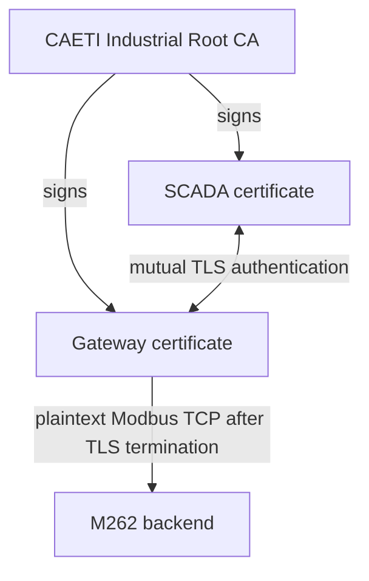

# industrialPKI

Portable industrial PKI / Modbus-TLS research testbed for a Schneider M262 + Delta traffic-light laboratory.

## Research goal

The strong target is end-to-end protection of Modbus traffic between the SCADA and the Schneider M262:

```text
SCADA ---------------- Modbus/TLS + mTLS / TCP 802 ----------------> M262
                              encrypted end to end
```

The Delta PLC remains the plaintext comparison path:

```text
SCADA ---------------------- Modbus TCP / 502 ---------------------> Delta
                               plaintext
```

## Current validated state

The current laboratory implementation has successfully validated the client-side PKI and TLS path:

```text
SCADA ---- Modbus/TLS / 802 ----> TLS Gateway ---- Modbus TCP ----> M262 emulator
             PKI + mTLS              terminates TLS       plaintext
```

Validated items:

- CAETI Root CA and X.509 certificates.
- Mutual TLS authentication.
- SCADA client using `ModbusTlsClient`.
- TLS gateway on TCP/802.
- M262 emulator backend on TCP/1502.
- Delta emulator on TCP/1503.
- Wireshark evidence of TLS 1.3 `Encrypted Application Data` on TCP/802.
- Positive/negative gateway test: with the TLS gateway stopped, a new/repeated M262 connection attempt fails even though the emulator remains alive; when the gateway is restored, reconnecting succeeds.

### SCADA connected through the TLS gateway


### M262 unavailable when the TLS gateway is stopped


### Wireshark evidence of encrypted TLS application data


Gateway and emulator evidence is intentionally documented as text output rather than terminal screenshots so it remains searchable, copyable, and reproducible.

## Critical limitation: end-to-end encryption is not yet proven

The current gateway-based proof of concept **does not provide end-to-end encryption up to the physical M262**. The gateway terminates TLS and forwards ordinary Modbus TCP to the backend.

Current validated path:

```text
SCADA ===== encrypted TLS/802 =====> Gateway ----- plaintext Modbus -----> backend
```

Therefore, a capture on the SCADA-to-gateway segment shows encrypted traffic, while a capture on the gateway-to-backend segment shows readable Modbus TCP.

The final end-to-end objective depends strictly on the physical M262 being able to terminate the TLS/mTLS session itself, either through native Modbus Security / Modbus-TLS support or through an equivalent TLS server capability exposed by the controller runtime.

Until that capability is verified on the physical M262, this repository must **not** claim end-to-end Modbus encryption to the PLC.

The next physical phase is therefore a **compatibility assessment**, not merely a deployment step.

See [`docs/PKI_Modbus_TLS_M262.md`](docs/PKI_Modbus_TLS_M262.md) for the complete procedure, validated testbed flow, Raspberry Pi deployment, and the physical M262 decision point.


## PKI trust model



Credential placement:

```text
CA workstation: rootCA.key + rootCA.crt
Raspberry gateway: rootCA.crt + gateway.crt + gateway.key
SCADA host: rootCA.crt + scada.crt + scada.key
```

`rootCA.key` never leaves the CA workstation.

## Repository layout

```text
industrialPKI/
├── attack/
├── docs/
│   └── images/
├── emulator/
├── gateway/
├── pki/
├── scada/
├── scripts/
├── docker-compose.yml
├── requirements.txt
├── .env.emulator
└── .env.physical
```

## Configuration profiles

The project keeps separate emulator and physical profiles.

```text
scada/scada_dual_config_emulator.json
scada/scada_dual_config_physical.json
```

The SCADA always reads:

```text
scada/scada_dual_config.json
```

Use:

```bash
./scripts/select_emulator.sh
```

or:

```bash
./scripts/select_physical.sh
```

before launching the corresponding environment.

## Security note

Private keys, local `.env` files, virtual environments, packet captures, and operational credentials must not be committed to a public GitHub repository. The CA private key must remain on the CA workstation.

## Fast laboratory start

From the repository root:

```bash
./scripts/bootstrap_dev.sh
./scripts/generate_pki.sh 192.168.0.24
./scripts/select_emulator.sh
```

Then use three terminals:

```bash
./scripts/run_emulator.sh
```

```bash
./scripts/run_gateway.sh
```

```bash
./scripts/run_scada.sh
```

Check the complete local state with:

```bash
./scripts/lab_status.sh
```

Run the repository sanity checks with:

```bash
./scripts/check_project.sh
```

## Raspberry Pi field gateway

The simplest lab workflow is to generate/sign credentials on the CA workstation and export the gateway bundle:

```bash
./scripts/export_credentials.sh
```

Transfer `dist/gateway_credentials.tar.gz` to the Raspberry Pi over a trusted channel. Never transfer `rootCA.key`.

On the Raspberry Pi, after Docker bootstrap and a logout/login so Docker group membership applies:

```bash
./scripts/provision_raspberry_gateway.sh /path/to/gateway_credentials.tar.gz 192.168.0.25 502
```

For detailed deployment steps and the end-to-end limitation, see:

- [`docs/PKI_Modbus_TLS_M262.md`](docs/PKI_Modbus_TLS_M262.md)
- [`docs/PKI_Modbus_TLS_M262_CAETI_Raspberry.md`](docs/PKI_Modbus_TLS_M262_CAETI_Raspberry.md)
- [`docs/FINAL_REVIEW.md`](docs/FINAL_REVIEW.md)
