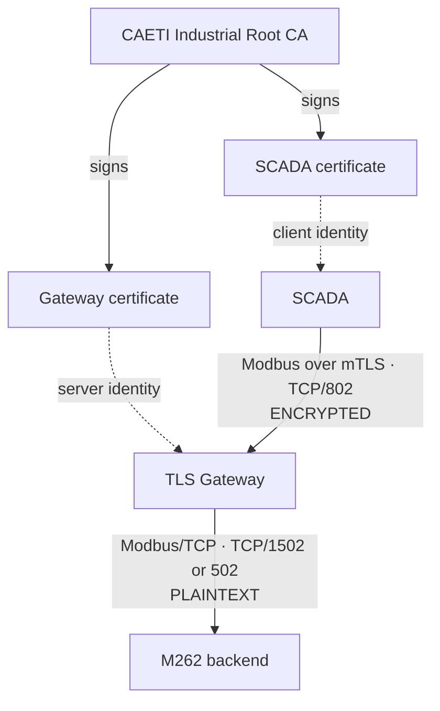

# industrialPKI

`industrialPKI` is a research testbed for applying PKI-backed mutual TLS to Modbus communications in a Schneider M262 + Delta PLC laboratory.

The project intentionally keeps the **Delta path in plaintext** as a comparison channel and protects the **M262 path up to a TLS gateway**.

> **Important security boundary**
>
> The current validated PoC encrypts and mutually authenticates the **SCADA ↔ TLS Gateway** segment.
>
> TLS terminates at the gateway. The **Gateway ↔ M262 backend** segment remains standard plaintext Modbus/TCP.
>
> True end-to-end encryption up to the physical M262 depends strictly on whether the M262 can terminate native Modbus/TLS (Modbus Security) or expose an equivalent compatible TLS server capability. That physical compatibility is the next validation phase and has not yet been demonstrated.

---

## 1. Current validated architecture

### M262 path

```text
SCADA
  |
  | Modbus over TLS + mTLS
  | TCP/802
  | ENCRYPTED
  v
TLS Gateway
  |
  | standard Modbus/TCP
  | TCP/1502 in the emulator testbed
  | TCP/502 with the physical M262
  | PLAINTEXT
  v
M262 backend
```

### Delta path

```text
SCADA ---------------- Modbus/TCP ----------------> Delta
                      PLAINTEXT
```

Laboratory ports are intentionally different from the physical PLC ports:

```text
M262 emulator       TCP/1502
Delta emulator      TCP/1503
TLS gateway         TCP/802
Physical Modbus     TCP/502
```

---

## 2. PKI trust model



Credential placement:

```text
CA workstation
  rootCA.key      private; never distributed
  rootCA.crt      public trust anchor

TLS gateway
  rootCA.crt
  gateway.crt
  gateway.key

SCADA host
  rootCA.crt
  scada.crt
  scada.key
```

The Root CA private key must never be committed to Git and must never be transferred to the gateway or SCADA host.

---

## 3. Validated results

The laboratory PoC has validated:

- CAETI Root CA and X.509 certificate issuance.
- Gateway and SCADA identities signed by the same CA.
- Mutual TLS authentication.
- TCP/802 TLS gateway operation.
- Encrypted TLS application data visible in Wireshark.
- Gateway connection to the M262 emulator backend on TCP/1502.
- Independent Delta emulator path on TCP/1503.
- Negative test: when the gateway is stopped, the M262 TLS path cannot establish a new connection even though the M262 emulator remains running.
- Positive test: when the gateway is restored, the protected M262 path can be re-established.

### SCADA connected through the TLS gateway


### M262 path unavailable when the TLS gateway is stopped


### Wireshark TLS evidence


Gateway and emulator evidence should be documented as text logs rather than terminal screenshots so that it remains searchable and reproducible.

Example gateway evidence:

```text
Certificate accepted at depth=0: C=AR, O=CAETI, OU=SCADA, CN=scada-testbed
s_connect: connected 172.17.0.1:1502
Service [modbus-m262] connected remote server
```

---

## 4. Repository layout

```text
industrialPKI/
├── attack/
├── docs/
│   └── images/
├── emulator/
├── gateway/
├── pki/
├── scada/
├── scripts/
├── docker-compose.yml
├── requirements.txt
├── .env.emulator
└── .env.physical
```

The public repository must not contain:

```text
*.key
*.csr
*.srl
.env
.venv/
dist/
pki_backup_*/
packet captures containing sensitive data
```

---

## 5. Local emulator testbed — shortest path

Run all commands from the repository root:

```bash
cd ~/Documents/Proyectos/industrialPKI
```

### First-time Python setup

```bash
python3 -m venv .venv
source .venv/bin/activate
python -m pip install --upgrade pip
pip install -r requirements.txt
```

If Tkinter is missing:

```bash
sudo apt update
sudo apt install python3-tk
```

### Select the emulator configuration

```bash
cp .env.emulator .env
cp scada/scada_dual_config_emulator.json scada/scada_dual_config.json
```

The emulator profile is:

```text
M262 SCADA endpoint     127.0.0.1:802  TLS
Gateway backend         host Docker -> TCP/1502
Delta SCADA endpoint    127.0.0.1:1503 TCP
```

### Terminal 1 — PLC emulator

```bash
cd ~/Documents/Proyectos/industrialPKI
source .venv/bin/activate
python emulator/plc_emulator.py
```

### Terminal 2 — TLS gateway

```bash
cd ~/Documents/Proyectos/industrialPKI
docker compose up -d --build
docker compose logs -f
```

### Terminal 3 — SCADA

```bash
cd ~/Documents/Proyectos/industrialPKI
source .venv/bin/activate
python scada/scada_dual_m262_delta.py
```

To stop the gateway:

```bash
docker compose down
```

---

## 6. PKI generation

Generate the CAETI PKI on the trusted CA workstation, not on the public GitHub repository.

Example, using the planned gateway IP `192.168.0.24`:

```bash
cd ~/Documents/Proyectos/industrialPKI
./scripts/generate_pki.sh 192.168.0.24
```

Expected identities:

```text
Root CA
C=AR
O=CAETI
OU=Industrial Security Lab
CN=CAETI Industrial Root CA

Gateway
C=AR
O=CAETI
OU=OT
CN=modbus-m262-gateway

SCADA
C=AR
O=CAETI
OU=SCADA
CN=scada-testbed
```

Verify:

```bash
openssl verify \
  -CAfile pki/ca/certs/rootCA.crt \
  pki/gateway/certs/gateway.crt \
  pki/scada/certs/scada.crt
```

Then export deployment bundles:

```bash
./scripts/export_credentials.sh
```

Expected output:

```text
dist/gateway_credentials.tar.gz
dist/scada_credentials.tar.gz
```

`rootCA.key` is not included in either bundle.

---

## 7. Raspberry Pi gateway deployment

The recommended field workflow is intentionally linear.

### On the CA/development workstation

1. Generate the PKI with the real Raspberry Pi gateway IP.
2. Export the credential bundles.
3. Transfer `gateway_credentials.tar.gz` to the Raspberry Pi using a trusted administrative channel.

The default PoC deployment transfers the gateway private key inside the protected bundle for simplicity and reproducibility.

For stronger production key custody, a future hardening step can generate `gateway.key` directly on the Raspberry Pi and use a CSR signing workflow. That is not required for the current PoC.

### On the Raspberry Pi — first installation only

Clone the repository:

```bash
git clone https://github.com/JFCrypT/industrialPKI.git
cd industrialPKI
```

Install Docker Engine and the Compose plugin:

```bash
./scripts/bootstrap_raspberry_gateway.sh
```

If the script adds the current user to the `docker` group, log out and back in once.

Verify:

```bash
docker --version
docker compose version
```

### Install gateway credentials

Assuming the bundle is in the home directory:

```bash
cd ~/industrialPKI

mkdir -p pki/ca/certs pki/gateway/certs pki/gateway/private

tmpdir="$(mktemp -d)"
tar -xzf ~/gateway_credentials.tar.gz -C "$tmpdir"

install -m 0644 "$tmpdir/gateway_credentials/rootCA.crt" \
  pki/ca/certs/rootCA.crt

install -m 0644 "$tmpdir/gateway_credentials/gateway.crt" \
  pki/gateway/certs/gateway.crt

install -m 0600 "$tmpdir/gateway_credentials/gateway.key" \
  pki/gateway/private/gateway.key

rm -rf "$tmpdir"
```

### Select the physical backend

The physical M262 backend is currently expected at:

```text
192.168.0.25:502
```

Activate the physical gateway profile:

```bash
cp .env.physical .env
cat .env
```

Expected:

```text
M262_IP=192.168.0.25
M262_PORT=502
```

### Start the gateway

```bash
docker compose up -d --build
docker compose ps
docker compose logs -f
```

The gateway listens on TCP/802 and forwards the decrypted Modbus stream to the M262 backend on TCP/502.

---

## 8. Physical SCADA profile

Before using the physical PLCs:

```bash
cp scada/scada_dual_config_physical.json scada/scada_dual_config.json
```

The intended physical topology is:

```text
M262 path
SCADA ---- mTLS/TCP 802 ----> Gateway ---- Modbus/TCP 502 ----> M262

Delta path
SCADA -------------------------- Modbus/TCP 502 -------------> Delta
```

Physical M262 coil addresses remain a field-validation item and must not be invented in advance.

---

## 9. Wireshark validation

### Protected side

Filter:

```text
tcp.port == 802
```

Expected:

```text
TLS
Client Hello
Server Hello
Application Data
Encrypted Application Data
```

Modbus function codes, coil addresses and values must not be readable in the encrypted payload.

### Backend side in the emulator testbed

Filter:

```text
tcp.port == 1502
```

Expected:

```text
standard Modbus/TCP
```

This demonstrates the current security boundary:

```text
SCADA -> Gateway      encrypted
Gateway -> backend    plaintext
```

---

## 10. End-to-end limitation and next physical phase

### What has been encrypted so far?

The project has encrypted **Modbus traffic between the SCADA and the TLS gateway**.

It has **not yet demonstrated end-to-end encrypted Modbus communication from the SCADA to the physical M262**.

### Why?

The gateway currently terminates TLS. After decryption, it forwards standard Modbus/TCP to the backend.

### What is required for true E2E protection?

The physical M262 must itself be able to terminate the protected session through one of these mechanisms:

1. native Modbus/TLS / Modbus Security support, or
2. an equivalent compatible TLS server capability exposed by the controller runtime.

This capability must be verified experimentally on the physical M262.

If the M262 cannot terminate TLS/mTLS, the external gateway architecture cannot provide cryptographic confidentiality over the final Gateway ↔ M262 segment.

Therefore:

```text
Current PoC:
SCADA == encrypted ==> Gateway -- plaintext --> M262

Target:
SCADA ============ encrypted end-to-end ============> M262
```

**The repository must not claim end-to-end M262 encryption until physical M262 compatibility is confirmed.**

---

## 11. Minimal operational scripts

The recommended public workflow needs only these scripts:

```text
scripts/generate_pki.sh
scripts/export_credentials.sh
scripts/bootstrap_raspberry_gateway.sh
```

Everything else can be performed with the explicit commands documented above.

Additional helper scripts may remain during development, but they are not required to understand or deploy the PoC and should not be presented as mandatory.

---

## 12. Project status

```text
CAETI PKI                                 VALIDATED
X.509 certificate chain                   VALIDATED
Mutual TLS authentication                 VALIDATED
Encrypted SCADA -> Gateway traffic        VALIDATED
TLS gateway on TCP/802                    VALIDATED
M262 emulator backend TCP/1502            VALIDATED
Delta emulator TCP/1503                   VALIDATED
Wireshark encrypted application data      VALIDATED
Raspberry deployment procedure            DOCUMENTED
Physical M262 Modbus addresses             PENDING FIELD VALIDATION
Native M262 Modbus/TLS capability          PENDING PHYSICAL VALIDATION
End-to-end SCADA -> M262 encryption        NOT YET DEMONSTRATED
```
