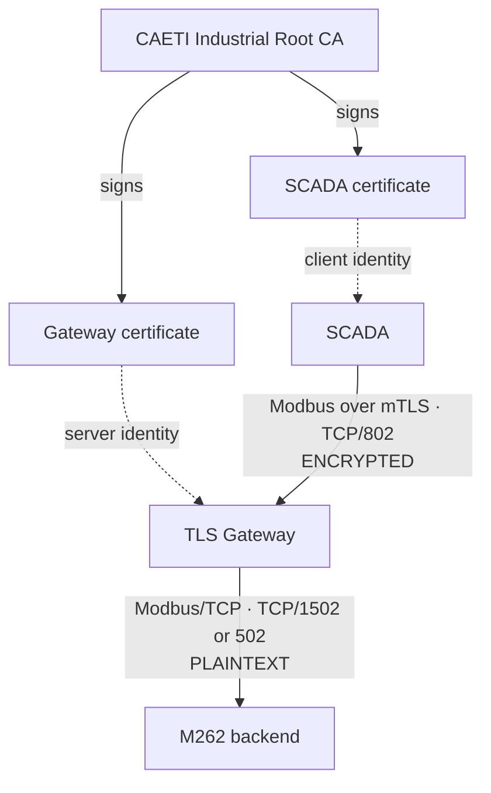
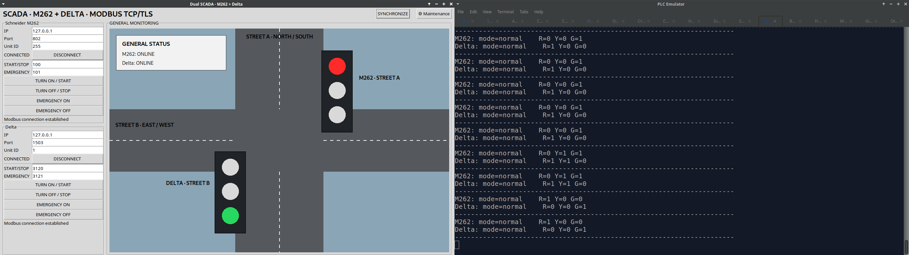
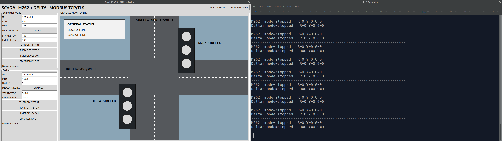
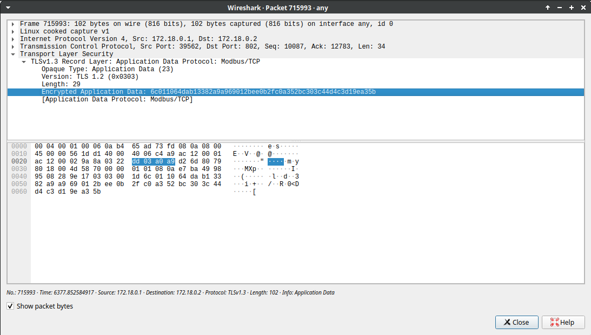
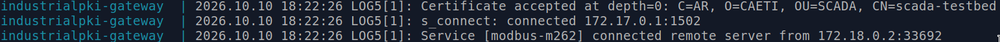

# industrialPKI

`industrialPKI` is a research testbed for applying PKI-backed mutual TLS to Modbus communications in a Schneider M262 + Delta PLC laboratory.

The project intentionally keeps the **Delta path in plaintext** as a comparison channel and protects the **M262 path up to a TLS gateway**.

> **Important security boundary**
>
> The current validated PoC encrypts and mutually authenticates the **SCADA ↔ TLS Gateway** segment.
>
> TLS terminates at the gateway. The **Gateway ↔ M262 backend** segment remains standard plaintext Modbus/TCP.
>
> True end-to-end encryption up to the physical M262 depends strictly on whether the M262 can terminate native Modbus/TLS (Modbus Security) or expose an equivalent compatible TLS server capability. That physical compatibility is the next validation phase and has not yet been demonstrated.

---

## Current validated architecture

### M262 path

```text
SCADA
  |
  | Modbus over TLS + mTLS
  | TCP/802
  | ENCRYPTED
  v
TLS Gateway
  |
  | standard Modbus/TCP
  | TCP/1502 in the emulator testbed
  | TCP/502 with the physical M262
  | PLAINTEXT
  v
M262 backend
```

### Delta path

```text
SCADA ---------------- Modbus/TCP ----------------> Delta
                      PLAINTEXT
```

Laboratory ports are intentionally different from the physical PLC ports:

```text
M262 emulator       TCP/1502
Delta emulator      TCP/1503
TLS gateway         TCP/802
Physical Modbus     TCP/502
```

---

## Cryptographic profile

The current PoC implements:

```text
Root CA key             RSA 4096-bit
Gateway key             RSA 3072-bit
SCADA key               RSA 3072-bit
Certificate signatures  SHA-256 with RSA
Certificate format      X.509 v3
TLS minimum             TLS 1.2
Observed TLS            TLS 1.3
Authentication          mutual TLS (mTLS)
```

The exact TLS session cipher suite and key-exchange group are **not hard-coded**. They are negotiated by Python/OpenSSL and stunnel/OpenSSL.

The repository therefore does not claim a fixed AES or ChaCha20 suite unless the negotiated session is explicitly captured.

See [`docs/CRYPTOGRAPHIC_PROFILE.md`](docs/CRYPTOGRAPHIC_PROFILE.md).

---

## PKI trust model



Credential placement:

```text
CA workstation
  rootCA.key      private; never distributed
  rootCA.crt      public trust anchor

TLS gateway
  rootCA.crt
  gateway.crt
  gateway.key

SCADA host
  rootCA.crt
  scada.crt
  scada.key
```

The Root CA private key must never be committed to Git and must never be transferred to the gateway or SCADA host.

---

## Validated results

The laboratory PoC has validated:

- CAETI Root CA and X.509 certificate issuance.
- Gateway and SCADA identities signed by the same CA.
- Mutual TLS authentication.
- TCP/802 TLS gateway operation.
- Encrypted TLS application data visible in Wireshark.
- Gateway connection to the M262 emulator backend on TCP/1502.
- Independent Delta emulator path on TCP/1503.
- Negative test: when the gateway is stopped, the M262 TLS path cannot establish a new connection even though the M262 emulator remains running.
- Positive test: when the gateway is restored, the protected M262 path can be re-established.

### SCADA connected through the TLS gateway



### M262 path unavailable when the TLS gateway is stopped



### Wireshark TLS evidence



### Gateway TLS connection



---

## Repository layout

```text
industrialPKI/
├── attack/
├── docs/
│   └── images/
├── emulator/
├── gateway/
├── pki/
├── scada/
├── scripts/
├── docker-compose.yml
├── requirements.txt
├── .env.emulator
└── .env.physical
```

The public repository must not contain:

```text
*.key
*.csr
*.srl
.env
.venv/
dist/
pki_backup_*/
*.code-workspace
```

---

## Local emulator testbed — shortest path

Run all commands from the repository root:

```bash
cd ~/Documents/Proyectos/industrialPKI
```

### First-time Python setup

```bash
python3 -m venv .venv
source .venv/bin/activate
python -m pip install --upgrade pip
pip install -r requirements.txt
```

If Tkinter is missing:

```bash
sudo apt update
sudo apt install python3-tk
```

### Select the emulator configuration

```bash
cp .env.emulator .env
cp scada/scada_dual_config_emulator.json scada/scada_dual_config.json
```

Expected `.env`:

```text
M262_IP=172.17.0.1
M262_PORT=1502
```

The emulator profile is:

```text
M262 SCADA endpoint     127.0.0.1:802  TLS
Gateway backend         Docker host -> TCP/1502
Delta SCADA endpoint    127.0.0.1:1503 TCP
```

### Terminal 1 — PLC emulator

```bash
cd ~/Documents/Proyectos/industrialPKI
source .venv/bin/activate
python emulator/plc_emulator.py
```

### Terminal 2 — TLS gateway

```bash
cd ~/Documents/Proyectos/industrialPKI
docker compose up -d --build
docker compose logs -f
```

### Terminal 3 — SCADA

```bash
cd ~/Documents/Proyectos/industrialPKI
source .venv/bin/activate
python scada/scada_dual_m262_delta.py
```

Connect and start the M262 from the GUI.

When the M262 connects, the gateway log should show the CAETI SCADA certificate and the backend connection.

Check whether the gateway is active:

```bash
docker compose ps
```

Check the TLS listener:

```bash
ss -ltnp | grep ':802'
```

Stop the gateway:

```bash
docker compose down
```

---

## PKI generation

Generate the CAETI PKI on the trusted CA workstation.

Example, using gateway IP `192.168.0.24`:

```bash
cd ~/Documents/Proyectos/industrialPKI
./scripts/generate_pki.sh 192.168.0.24
```

Expected identities:

```text
Root CA
C=AR
O=CAETI
OU=Industrial Security Lab
CN=CAETI Industrial Root CA

Gateway
C=AR
O=CAETI
OU=OT
CN=modbus-m262-gateway

SCADA
C=AR
O=CAETI
OU=SCADA
CN=scada-testbed
```

Verify:

```bash
openssl verify \
  -CAfile pki/ca/certs/rootCA.crt \
  pki/gateway/certs/gateway.crt \
  pki/scada/certs/scada.crt
```

Export deployment bundles:

```bash
./scripts/export_credentials.sh
```

Expected:

```text
dist/gateway_credentials.tar.gz
dist/scada_credentials.tar.gz
```

`rootCA.key` is never included in either bundle.

---

## Raspberry Pi gateway deployment

The current field workflow is intentionally linear.

### On the CA/development workstation

1. Generate the PKI with the real Raspberry Pi gateway IP.
2. Export the credential bundles.
3. Transfer only the gateway credentials to the Raspberry Pi using a trusted administrative channel.

The gateway requires:

```text
rootCA.crt
gateway.crt
gateway.key
```

The Root CA private key stays on the CA workstation.

### On the Raspberry Pi — first installation only

```bash
cd /home/usuario/Documents/
git clone https://github.com/JFCrypT/industrialPKI.git
cd industrialPKI
```

Install Docker and Docker Compose:

```bash
./scripts/bootstrap_raspberry_gateway.sh
```

If the script adds the current user to the `docker` group, log out and back in once.

### Install gateway credentials from `bundle.zip`

Assuming:

```text
/home/usuario/Documents/bundle.zip
```

contains directly:

```text
rootCA.crt
gateway.crt
gateway.key
```

run from:

```text
/home/usuario/Documents/industrialPKI
```

```bash
mkdir -p pki/ca/certs pki/gateway/certs pki/gateway/private

tmpdir="$(mktemp -d)"

unzip /home/usuario/Documents/bundle.zip -d "$tmpdir"

install -m 0644 "$tmpdir/rootCA.crt" \
  pki/ca/certs/rootCA.crt

install -m 0644 "$tmpdir/gateway.crt" \
  pki/gateway/certs/gateway.crt

install -m 0600 "$tmpdir/gateway.key" \
  pki/gateway/private/gateway.key

rm -rf "$tmpdir"
```

### Emulator demonstration on the Raspberry Pi

Select the emulator profile:

```bash
cp .env.emulator .env
cp scada/scada_dual_config_emulator.json \
   scada/scada_dual_config.json
```

Verify:

```bash
cat .env
```

Expected:

```text
M262_IP=172.17.0.1
M262_PORT=1502
```

Create the Python environment:

```bash
sudo apt install python3-tk
python3 -m venv .venv
source .venv/bin/activate
python -m pip install --upgrade pip
pip install -r requirements.txt
```

Run in three terminals.

Terminal 1:

```bash
source .venv/bin/activate
python emulator/plc_emulator.py
```

Terminal 2:

```bash
docker compose up -d --build
docker compose logs -f
```

Terminal 3:

```bash
source .venv/bin/activate
python scada/scada_dual_m262_delta.py
```

Connect and start the M262 from the GUI.

---

## Physical SCADA / M262 profile

For the current gateway-based physical PoC:

```bash
cp .env.physical .env
cp scada/scada_dual_config_physical.json scada/scada_dual_config.json
```

Current intended topology:

```text
M262 path
SCADA ---- mTLS/TCP 802 ----> Gateway ---- Modbus/TCP 502 ----> M262

Delta path
SCADA -------------------------- Modbus/TCP 502 -------------> Delta
```

Physical M262 coil addresses remain a field-validation item and must not be invented in advance.

---

## Wireshark validation

### Protected side

Filter:

```text
tcp.port == 802
```

Expected:

```text
TLS
Client Hello
Server Hello
Application Data
Encrypted Application Data
```

Modbus function codes, coil addresses and values must not be readable in plaintext.

### Backend side in the emulator testbed

Filter:

```text
tcp.port == 1502
```

Expected:

```text
standard Modbus/TCP
```

This demonstrates the current security boundary:

```text
SCADA -> Gateway      encrypted
Gateway -> backend    plaintext
```

---

## End-to-end limitation and next physical phase

### What has been encrypted so far?

The project has encrypted **Modbus traffic between the SCADA and the TLS gateway**.

It has **not yet demonstrated end-to-end encrypted Modbus communication from the SCADA to the physical M262**.

### Why?

The gateway currently terminates TLS. After decryption, it forwards standard Modbus/TCP to the backend.

### What is required for true E2E protection?

The physical M262 must itself be able to terminate the protected session through one of these mechanisms:

1. native Modbus/TLS / Modbus Security support, or
2. an equivalent compatible TLS server capability exposed by the controller runtime.

This capability must be verified experimentally on the physical M262.

If the M262 can terminate Modbus/TLS directly, the target architecture becomes:

```text
SCADA ===== Modbus/TLS + mTLS / TCP 802 =====> M262
                 ENCRYPTED END TO END
```

In that case, the external TLS gateway is no longer required in the main SCADA-to-M262 communication path.

If the M262 cannot terminate TLS/mTLS, the external gateway architecture cannot provide cryptographic confidentiality over the final Gateway ↔ M262 segment.

Therefore:

```text
Current PoC:
SCADA == encrypted ==> Gateway -- plaintext --> M262

Target:
SCADA ============ encrypted end-to-end ============> M262
```

**The repository must not claim end-to-end M262 encryption until physical M262 compatibility is confirmed.**

---

## Project status

```text
CAETI PKI                                 VALIDATED
X.509 certificate chain                   VALIDATED
RSA-4096 Root CA                          VALIDATED
RSA-3072 SCADA/Gateway identities         VALIDATED
SHA-256 with RSA certificate signatures  VALIDATED
Mutual TLS authentication                 VALIDATED
TLS 1.2 minimum                           CONFIGURED
TLS 1.3                                   OBSERVED
Encrypted SCADA -> Gateway traffic        VALIDATED
TLS gateway on TCP/802                    VALIDATED
M262 emulator backend TCP/1502            VALIDATED
Delta emulator TCP/1503                   VALIDATED
Wireshark encrypted application data      VALIDATED
Raspberry deployment procedure            DOCUMENTED
Physical M262 Modbus addresses             PENDING FIELD VALIDATION
Native M262 Modbus/TLS capability          PENDING PHYSICAL VALIDATION
End-to-end SCADA -> M262 encryption        NOT YET DEMONSTRATED
```
