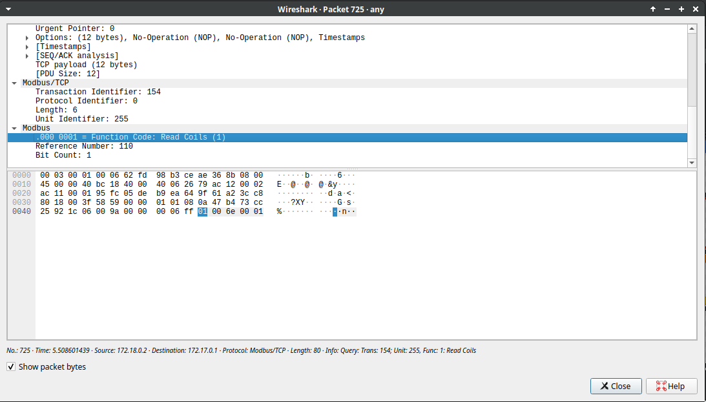

# M262 Security Boundary and Modbus TCP Interoperability

This document records two separate issues that must not be confused:

1. the **security boundary** of the current PKI/TLS demonstration, and
2. the **plain Modbus TCP interoperability requirements** of the physical Schneider M262.

---

## 1. Current laboratory security boundary

The current validated M262 path is:

```text
SCADA
  |
  | Modbus over TLS + mTLS
  | TCP/802
  | ENCRYPTED
  v
TLS Gateway
  |
  | standard Modbus/TCP
  | TCP/1502 in the emulator testbed
  | PLAINTEXT
  v
M262 emulator
```

The SCADA already contains a TLS-capable client layer in `scada_dual_m262_delta.py`.
The application configures Python `ssl`, loads the SCADA certificate and private key,
and uses a TLS-capable PyModbus client. The low-level TLS handshake, session-key
derivation, encryption and decryption are performed by Python/OpenSSL.

The M262 emulator does **not** implement native TLS. Therefore the external gateway
terminates TLS and translates between:

```text
SCADA side      TLS/mTLS, encrypted
backend side    ordinary Modbus/TCP, plaintext
```

### Direction SCADA -> M262 emulator

```text
SCADA application
    |
    | ordinary Modbus request
    v
SCADA TLS layer
    |
    | encrypts
    v
network TCP/802
    |
    | ciphertext
    v
TLS Gateway
    |
    | decrypts
    v
TCP/1502
    |
    | plaintext Modbus/TCP
    v
M262 emulator
```

### Direction M262 emulator -> SCADA

```text
M262 emulator
    |
    | plaintext Modbus/TCP / 1502
    v
TLS Gateway
    |
    | encrypts
    v
network TCP/802
    |
    | ciphertext
    v
SCADA TLS layer
    |
    | decrypts
    v
SCADA application / GUI
```

---

## 3. Bidirectional packet-capture interpretation

The security boundary must be interpreted in both directions.

### Capture on TCP/802

Filter:

```text
tcp.port == 802
```

This captures the TLS session between the SCADA and the gateway:

```text
SCADA -> Gateway    TLS encrypted
Gateway -> SCADA    TLS encrypted
```

For SCADA-to-gateway traffic, the SCADA TLS layer encrypts the Modbus request before it enters the network.

For gateway-to-SCADA traffic, the gateway encrypts the Modbus response before transmitting it, and the SCADA TLS layer decrypts it locally before PyModbus and the GUI process it.

A passive observer on this segment should see TLS records / Application Data rather than directly readable Modbus function codes, addresses or values.

### Capture on TCP/1502

Filter:

```text
tcp.port == 1502
```

This captures the plaintext backend between the TLS gateway and the M262 emulator:

```text
Gateway -> M262 emulator    plaintext Modbus/TCP
M262 emulator -> Gateway    plaintext Modbus/TCP
```

For gateway-to-M262 traffic, the gateway has already terminated and decrypted TLS before forwarding the Modbus request.

For M262-to-gateway traffic, the emulator sends ordinary Modbus/TCP to the gateway; the gateway subsequently encrypts that response when forwarding it toward the SCADA on TCP/802.

Wireshark can therefore decode on TCP/1502:

```text
Unit ID
Function Code
coil/register address
read/write values
```

### Wireshark evidence: plaintext M262 backend

Save the TCP/1502 capture as:

```text
docs/images/m262_backend_plaintext_modbus.png
```

and include it in the repository:



The image demonstrates that both directions of the gateway-to-M262-emulator backend are ordinary readable Modbus/TCP after TLS termination.

It complements the TCP/802 TLS capture:

```text
TCP/802   SCADA <-> Gateway         encrypted in both directions
TCP/1502  Gateway <-> M262 emulator plaintext in both directions
```

### Compact rule

```text
TCP/802   SCADA <-> Gateway         encrypted in both directions
TCP/1502  Gateway <-> M262 emulator plaintext in both directions
```

The current security limitation is therefore not direction-specific. It is the complete plaintext backend segment between the gateway and the current M262 endpoint.

---

## 2. Current vulnerable point

For the protected M262 path, the only intentionally plaintext **network segment**
currently present is the complete bidirectional backend after TLS termination:

```text
TLS Gateway <---- plaintext Modbus/TCP ----> M262 backend
```

In the emulator testbed this is:

```text
Gateway <---- TCP/1502 ----> M262 emulator
```

Wireshark can decode this traffic and display the Modbus Unit ID, function code,
coil address and values.

The same limitation would remain in a physical deployment if the external gateway
were retained:

```text
SCADA == TLS/mTLS ==> Gateway -- plaintext Modbus/TCP/502 --> physical M262
```

### Backend bypass exposure in the emulator

The emulator currently binds its M262 server to:

```text
0.0.0.0:1502
```

Therefore TCP/1502 is not only a plaintext backend segment; it may also be reachable
directly from host interfaces depending on host firewall and network configuration.
This is acceptable for the isolated demonstration testbed, but it must not be
confused with an end-to-end protected architecture.

---

## 3. End-to-end target

The desired final architecture is:

```text
SCADA ===== native Modbus/TLS + mTLS / TCP 802 =====> M262
```

For this architecture:

- the external TLS gateway is removed from the SCADA-to-M262 data path;
- the SCADA and M262 perform the TLS handshake directly;
- the M262 becomes a direct PKI participant with its own certificate and private key;
- no intermediate plaintext Modbus network segment remains;
- a passive network sniffer sees TLS ciphertext instead of readable Modbus.

The remaining condition is physical verification that the M262 can terminate
compatible Modbus/TLS / Modbus Security.

If native secure Modbus is enabled, any parallel plaintext Modbus/TCP service on
TCP/502 must also be disabled or filtered if the objective is to eliminate a
plaintext bypass path.

---

## 4. What the physical M262 provides for standard Modbus TCP

Schneider documents an **embedded Modbus TCP server** in the M262 firmware.

Important consequence:

> No PLC application code is required merely to make the embedded M262 answer
> standard Modbus TCP requests.

The embedded server is available in RUNNING, STOPPED and EMPTY controller states.

Default endpoint:

```text
TCP port: 502
Unit ID: 255
```

The embedded Modbus server is the correct server for the current SCADA coil-based
test because it exposes `%Q`, `%I` and `%MW`.

Do not confuse it with the optional **Modbus TCP Slave Device** object. That optional
object uses a Unit ID in the range `1..247` and exposes a separate `%IW/%QW`
register-oriented exchange area.

---

## 5. Supported M262 embedded-server function codes

The embedded M262 server supports:

```text
FC01   Read digital outputs (%Q)
FC02   Read digital inputs (%I)
FC03   Read holding registers (%MW)
FC06   Write single register (%MW)
FC08   Diagnostics
FC15   Write multiple digital outputs (%Q)
FC16   Write multiple registers (%MW)
FC23   Read/write multiple registers (%MW)
FC43/14 Read device identification
```

### Critical PyModbus compatibility point

The embedded M262 server documentation does **not** list:

```text
FC05 - Write Single Coil
```

as a supported request.

Therefore a PyModbus call such as:

```python
client.write_coil(...)
```

must not be the primary write method for the physical M262.

For the M262, use:

```python
client.write_coils(address, [value], device_id=255)
```

which generates FC15 even when only one output bit is being written.

This is an important correction to the SCADA implementation.

Delta can continue using FC05 if its PLC accepts it.

---

## 6. M262 configuration required in EcoStruxure Machine Expert

For the standard embedded Modbus TCP server, there should be no ladder/ST function
block required just to accept PyModbus.

Check the following instead.

### 6.1 Correct Ethernet interface and IP address

Confirm the IP address of the Ethernet interface physically connected to the SCADA
or gateway network.

The M262 has multiple Ethernet interfaces depending on model. Verify the exact
interface being used rather than assuming the IP belongs to the cable currently
connected.

### 6.2 Modbus Server enabled on that interface

The M262 security settings can enable or disable the **Modbus Server** independently
on communication interfaces.

The Modbus Server service is TCP/502.

Interface bit mask:

```text
bit 0  USB
bit 1  ETH1
bit 2  ETH2
bit 3  TMSES4 #1
bit 4  TMSES4 #2
bit 5  TMSES4 #3
```

For a laboratory test, confirm that the bit corresponding to the Ethernet interface
in use is enabled.

Examples:

```text
ETH1 only       2
ETH2 only       4
ETH1 + ETH2     6
all interfaces  255
```

Do not change production security policy blindly; these values are useful for
diagnosis of the laboratory configuration.

### 6.3 Firewall

If the controller firewall is enabled, TCP/502 must be explicitly permitted on the
interface used by the SCADA/gateway.

If the firewall is disabled, this is not the cause of a refused connection.

### 6.4 Port

Default embedded Modbus TCP port:

```text
502
```

The M262 can change the Modbus port through `changeModbusPort`, but a power cycle
returns it to TCP/502. For this project, keep TCP/502 unless there is a specific
reason to change it.

### 6.5 Unit ID

Use:

```text
255
```

for the embedded Modbus server.

A Unit ID from `1..247` is used when addressing a configured Modbus TCP Slave Device
object, which is a different exchange model.

---

## 7. Recommended physical connectivity test before PKI integration

Before involving the TLS gateway, prove plain PyModbus interoperability directly
against the physical M262.

From the SCADA notebook:

```bash
nc -vz 192.168.0.25 502
```

Expected:

```text
connection succeeded
```

Then use a minimal Python test with:

```python
from pymodbus.client import ModbusTcpClient

client = ModbusTcpClient("192.168.0.25", port=502)

if not client.connect():
    raise SystemExit("TCP/502 connection failed")

result = client.read_coils(
    0,
    count=1,
    device_id=255,
)

print(result)

client.close()
```

The test address `0` is only a connectivity/example address. The actual `%Q`
addresses used by the project must be confirmed from the physical M262 application
and I/O mapping.

After basic reads work, test writes with **FC15**:

```python
result = client.write_coils(
    confirmed_output_address,
    [True],
    device_id=255,
)
```

Do not use FC05 as the acceptance test for the M262.

---

## 8. Diagnostic order for the previous SCADA connection failure

Use this order so that network, Modbus and PKI failures are not mixed together.

```text
1. ping M262 IP
2. verify correct Ethernet interface/IP in Machine Expert
3. nc -vz M262_IP 502
4. verify Modbus Server enabled on the interface
5. verify firewall policy if firewall is enabled
6. connect with ModbusTcpClient to M262_IP:502
7. use Unit ID 255
8. perform a supported request, preferably FC01 or FC43/14
9. test writes with FC15, not FC05
10. confirm the real M262 %Q addresses
11. only then place the TLS gateway back in the path
```

If step 3 fails, the problem is below PyModbus: IP/interface/service/firewall/port.

If step 3 succeeds but a Modbus request fails, inspect Unit ID, function code and
address mapping.

If direct Modbus TCP works but the gateway path fails, investigate only the TLS
gateway configuration.

---

## 9. Physical gateway PoC after direct M262 validation

Once direct plain Modbus TCP is proven:

```text
SCADA == TLS/mTLS/802 ==> Gateway -- Modbus/TCP/502 --> M262
```

Gateway backend configuration:

```text
M262_IP=192.168.0.25
M262_PORT=502
```

The SCADA still connects to the gateway, not directly to TCP/502, in this gateway
PoC.

---

## 10. Native Modbus/TLS decision

The final physical test must separately determine whether the M262 itself provides
a native Modbus/TLS / Modbus Security endpoint.

If supported:

```text
SCADA ===== mTLS / Modbus Security =====> M262
```

and the gateway is removed from the primary communication path.

If not supported:

```text
SCADA ===== TLS =====> Gateway ----- plaintext Modbus/TCP -----> M262
```

and the final plaintext hop remains a documented architectural limitation.

The project must not claim end-to-end M262 encryption until direct secure
SCADA-to-M262 communication has been experimentally verified.
