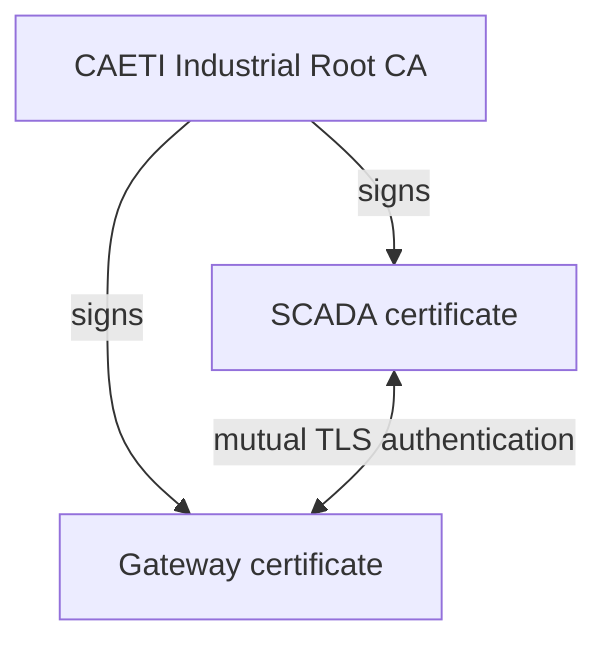

# CAETI PKI and Modbus/TLS Testbed — Complete Technical Procedure

This document is the technical reference for the `industrialPKI` proof of concept.

For the shortest operational path, read the repository `README.md` first.

---

## 1. Security objective

The long-term target is:

```text
SCADA ---------------- Modbus/TLS + mTLS / TCP 802 ----------------> M262
                              encrypted end to end
```

The current validated PoC is:

```text
SCADA ---- encrypted mTLS / TCP 802 ----> TLS Gateway ---- plaintext Modbus/TCP ----> M262 backend
```

This distinction is fundamental.

The present PoC proves PKI, mutual authentication, TLS confidentiality and SCADA integration **up to the gateway**.

It does not yet prove end-to-end confidentiality up to the physical PLC.

---

## 2. Current security boundary


The gateway is a TLS termination point.

A passive observer on the SCADA-to-gateway segment sees TLS ciphertext.

A passive observer on the gateway-to-M262 segment can see standard Modbus/TCP because TLS has already been terminated.

---

## 3. PKI model



Identity convention:

```text
Root CA
C=AR
O=CAETI
OU=Industrial Security Lab
CN=CAETI Industrial Root CA

Gateway
C=AR
O=CAETI
OU=OT
CN=modbus-m262-gateway

SCADA
C=AR
O=CAETI
OU=SCADA
CN=scada-testbed
```

Credential distribution:

```text
CA workstation
  rootCA.key
  rootCA.crt

Gateway
  rootCA.crt
  gateway.crt
  gateway.key

SCADA
  rootCA.crt
  scada.crt
  scada.key
```

`rootCA.key` remains exclusively on the trusted CA workstation.

---

## 4. Generate the PKI

From the repository root:

```bash
./scripts/generate_pki.sh <GATEWAY_IP>
```

Example:

```bash
./scripts/generate_pki.sh 192.168.0.24
```

The generated gateway certificate includes the physical gateway IP in the Subject Alternative Name.

Verify:

```bash
openssl verify \
  -CAfile pki/ca/certs/rootCA.crt \
  pki/gateway/certs/gateway.crt \
  pki/scada/certs/scada.crt
```

Inspect identities:

```bash
openssl x509 -in pki/ca/certs/rootCA.crt -noout -subject
openssl x509 -in pki/gateway/certs/gateway.crt -noout -subject
openssl x509 -in pki/scada/certs/scada.crt -noout -subject
```

All operational identities must use `O = CAETI`.

---

## 5. Export credentials

```bash
./scripts/export_credentials.sh
```

Output:

```text
dist/gateway_credentials.tar.gz
dist/scada_credentials.tar.gz
```

Gateway bundle:

```text
rootCA.crt
gateway.crt
gateway.key
```

SCADA bundle:

```text
rootCA.crt
scada.crt
scada.key
```

The Root CA private key is never exported.

Transfer the deployment bundles only over a trusted encrypted administrative channel or controlled removable media.

---

## 6. Local testbed configuration

### Python environment

```bash
python3 -m venv .venv
source .venv/bin/activate
python -m pip install --upgrade pip
pip install -r requirements.txt
```

### Emulator profile

```bash
cp .env.emulator .env
cp scada/scada_dual_config_emulator.json scada/scada_dual_config.json
```

Expected endpoints:

```text
SCADA -> M262 TLS gateway   127.0.0.1:802
Gateway -> M262 emulator    TCP/1502
SCADA -> Delta emulator     127.0.0.1:1503
```

### Terminal 1

```bash
source .venv/bin/activate
python emulator/plc_emulator.py
```

### Terminal 2

```bash
docker compose up -d --build
docker compose logs -f
```

### Terminal 3

```bash
source .venv/bin/activate
python scada/scada_dual_m262_delta.py
```

---

## 7. Expected gateway evidence

A successful SCADA connection produces log entries such as:

```text
Service [modbus-m262] accepted connection ...
Certificate accepted at depth=0: C=AR, O=CAETI, OU=SCADA, CN=scada-testbed
s_connect: connected 172.17.0.1:1502
Service [modbus-m262] connected remote server ...
```

Interpretation:

```text
certificate accepted
  -> SCADA identity trusted by the gateway

connected 172.17.0.1:1502
  -> gateway reached the M262 emulator backend
```

---

## 8. Negative gateway test

Stop the gateway:

```bash
docker compose down
```

The M262 emulator may remain alive on TCP/1502, but a new SCADA connection through TCP/802 must fail.

Restart:

```bash
docker compose up -d
```

Then reconnect the M262 path from the SCADA.

This verifies that the SCADA protected path depends on the TLS gateway and does not intentionally bypass it.

The stable GUI does not claim to be a transport-health monitoring system; an already-open visual state may need an explicit disconnect/reconnect or fresh operation to reflect a gateway failure.

---

## 9. Wireshark evidence

Protected segment:

```text
tcp.port == 802
```

Expected:

```text
TLSv1.2 or TLSv1.3
Client Hello
Server Hello
Application Data
Encrypted Application Data
```

Emulator backend:

```text
tcp.port == 1502
```

Expected: standard Modbus/TCP after TLS termination.

The two captures represent the same architectural boundary:

```text
before TLS termination    encrypted
after TLS termination     plaintext
```

---

## 10. Raspberry Pi physical gateway

For the complete field procedure, see:

```text
docs/PKI_Modbus_TLS_M262_CAETI_Raspberry.md
```

The deployment principle is:

```text
SCADA -> mTLS/TCP 802 -> Raspberry Pi Gateway -> Modbus/TCP 502 -> M262
```

This is still not end-to-end encryption to the PLC because TLS terminates on the Raspberry Pi.

---

## 11. Physical M262 decision point

End-to-end confidentiality requires the physical M262 itself to terminate the protected channel.

The next experiment must answer:

> Does the specific Schneider M262 configuration support native Modbus/TLS / Modbus Security with certificate-based authentication on the PLC itself, or expose an equivalent usable TLS server capability?

If yes:

```text
SCADA ===== Modbus/TLS + mTLS =====> M262
```

If no:

```text
SCADA ===== TLS =====> Gateway ----- plaintext Modbus -----> M262
```

In the second case the final segment cannot be described as cryptographically protected.

---

## 12. Claims that are supported now

Supported:

```text
PKI-backed mutual TLS
SCADA identity authentication
Gateway identity authentication
Encrypted SCADA-to-gateway transport
TLS traffic on TCP/802
Modbus backend forwarding
Wireshark encrypted application data
Portable Linux/Raspberry gateway deployment
```

Not yet supported:

```text
native M262 Modbus/TLS
end-to-end SCADA-to-M262 confidentiality
end-to-end SCADA-to-M262 integrity/authentication at the PLC endpoint
```
