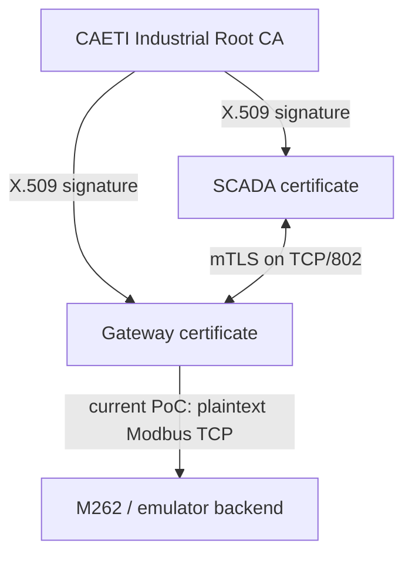

# industrialPKI — CAETI PKI, Modbus/TLS Testbed and Raspberry Pi Deployment

## 1. Purpose and final security objective

The final research objective is to protect Modbus communication to the Schneider M262 with PKI-backed mutual TLS while retaining the Delta PLC as the plaintext comparison path.

Strong end-to-end target:

```text
M262
SCADA ---------------- Modbus/TLS + mTLS / TCP 802 ----------------> M262
                              encrypted end to end

Delta
SCADA ---------------------- Modbus TCP / 502 ---------------------> Delta
                               plaintext
```

### Critical condition for the final objective

End-to-end encryption depends strictly on the **physical M262 being able to terminate TLS/mTLS itself**.

That requires one of the following to exist and be usable on the M262:

1. native Modbus Security / Modbus-TLS server support, or
2. an equivalent programmable TLS server capability in the M262 runtime that can securely terminate the TLS session and expose the required Modbus semantics.

If the physical M262 cannot terminate TLS/mTLS, then an external gateway can only protect the network up to the gateway. The final gateway-to-M262 hop remains plaintext Modbus TCP.

Therefore, **the current laboratory gateway implementation is a validated TLS/PKI proof of concept, not yet proof of end-to-end encryption to the physical PLC**.

---

## 2. Current validated laboratory architecture

The implementation already validated is:

```text
SCADA ---- Modbus/TLS / 802 ----> TLS Gateway ---- Modbus TCP / 1502 ----> M262 emulator
             PKI + mTLS              TLS termination        plaintext

SCADA ---------------------- Modbus TCP / 1503 ---------------------> Delta emulator
                               plaintext
```

Validated results:

- CAETI Root CA created.
- Gateway X.509 certificate created.
- SCADA client X.509 certificate created.
- Certificate chain verified.
- Mutual TLS handshake validated.
- SCADA `ModbusTlsClient` validated.
- Gateway listens on TCP/802.
- Gateway reaches the M262 emulator on TCP/1502.
- Delta emulator works directly on TCP/1503.
- Wireshark shows TLS 1.3 `Encrypted Application Data` on TCP/802.
- Gateway stop test prevents M262 SCADA communication while the emulator itself remains alive.
- Gateway restart restores the M262 path.

### SCADA connected through TLS


### TLS gateway stopped


---


## PKI trust and credential placement



```text
CA workstation
  rootCA.key      PRIVATE; never transferred
  rootCA.crt

Raspberry gateway
  rootCA.crt
  gateway.crt
  gateway.key

SCADA host
  rootCA.crt
  scada.crt
  scada.key
```

## 3. Repository structure

```text
industrialPKI/
├── attack/
├── docs/
│   └── images/
├── emulator/
├── gateway/
├── pki/
├── scada/
├── scripts/
├── docker-compose.yml
├── requirements.txt
├── .env.emulator
└── .env.physical
```

Run all project commands from the repository root unless otherwise stated.

Example local path:

```bash
cd ~/Documents/Proyectos/industrialPKI
```

---

## 4. Python virtual environment

Create the environment:

```bash
python3 -m venv .venv
source .venv/bin/activate
python -m pip install --upgrade pip
pip install -r requirements.txt
```

Install Tkinter if needed:

```bash
sudo apt update
sudo apt install python3-tk
```

Check PyModbus:

```bash
python -c "import pymodbus; print(pymodbus.__version__)"
```

The validated laboratory environment uses PyModbus 3.15.0.

Activate the environment later with:

```bash
source .venv/bin/activate
```

Leave it with:

```bash
deactivate
```

---

## 5. Configuration profiles

The SCADA always reads:

```text
scada/scada_dual_config.json
```

Two profiles are maintained:

```text
scada/scada_dual_config_emulator.json
scada/scada_dual_config_physical.json
```

### Select emulator mode

```bash
./scripts/select_emulator.sh
```

Equivalent commands:

```bash
cp .env.emulator .env
cp scada/scada_dual_config_emulator.json scada/scada_dual_config.json
```

### Select physical mode

```bash
./scripts/select_physical.sh
```

Equivalent commands:

```bash
cp .env.physical .env
cp scada/scada_dual_config_physical.json scada/scada_dual_config.json
```

The different laboratory ports are intentional:

```text
M262 emulator -> TCP/1502
Delta emulator -> TCP/1503
TLS gateway client side -> TCP/802
physical Modbus TCP -> TCP/502
```

---

## 6. CAETI PKI identities

Current PKI identity convention:

```text
Root CA
C=AR
O=CAETI
OU=Industrial Security Lab
CN=CAETI Industrial Root CA

Gateway
C=AR
O=CAETI
OU=OT
CN=modbus-m262-gateway

SCADA
C=AR
O=CAETI
OU=SCADA
CN=scada-testbed
```

PKI material:

```text
pki/ca/private/rootCA.key
pki/ca/certs/rootCA.crt

pki/gateway/private/gateway.key
pki/gateway/certs/gateway.crt

pki/scada/private/scada.key
pki/scada/certs/scada.crt
```

Verify the chain:

```bash
openssl verify \
  -CAfile pki/ca/certs/rootCA.crt \
  pki/gateway/certs/gateway.crt \
  pki/scada/certs/scada.crt
```

Expected:

```text
pki/gateway/certs/gateway.crt: OK
pki/scada/certs/scada.crt: OK
```

Check subjects:

```bash
openssl x509 -in pki/ca/certs/rootCA.crt -noout -subject
openssl x509 -in pki/gateway/certs/gateway.crt -noout -subject
openssl x509 -in pki/scada/certs/scada.crt -noout -subject
```

The gateway log should identify the SCADA as:

```text
Certificate accepted at depth=0: C=AR, O=CAETI, OU=SCADA, CN=scada-testbed
```

### Secret-handling rule

Never publish or distribute the CA private key:

```text
rootCA.key
```

The Root CA private key remains on the CA workstation.

---

## 7. Docker TLS gateway

Check Docker:

```bash
docker --version
docker compose version
sudo systemctl enable --now docker
```

The gateway exposes:

```text
TCP/802
```

and forwards decrypted traffic to the backend configured by `.env`.

### Emulator backend

`.env.emulator` points the gateway to the M262 emulator on port 1502.

### Physical backend for the current gateway PoC

`.env.physical` points the gateway to the physical M262 Modbus TCP server on port 502.

**Important:** this physical gateway mode does not provide end-to-end encryption. TLS ends at the gateway and the 502 hop is plaintext.

Start/rebuild:

```bash
docker compose build
docker compose up -d
docker compose ps
```

View logs:

```bash
docker compose logs -f
```

Stop:

```bash
docker compose down
```

A successful startup includes:

```text
Configuration successful
```

---

## 8. Fast local startup — three terminals

### Terminal 1 — PLC emulator

```bash
cd ~/Documents/Proyectos/industrialPKI
source .venv/bin/activate
./scripts/select_emulator.sh
python emulator/plc_emulator.py
```

Expected listeners:

```text
M262 emulator: 0.0.0.0:1502
Delta emulator: 0.0.0.0:1503
```

Check:

```bash
ss -ltnp | grep -E ':1502|:1503'
```

### Terminal 2 — TLS gateway

```bash
cd ~/Documents/Proyectos/industrialPKI
./scripts/select_emulator.sh
docker compose up -d
docker compose logs -f
```

Expected path:

```text
SCADA -> TLS/802 -> Gateway -> Modbus TCP/1502 -> M262 emulator
```

### Terminal 3 — SCADA

```bash
cd ~/Documents/Proyectos/industrialPKI
source .venv/bin/activate
python scada/scada_dual_m262_delta.py
```

Emulator endpoints:

```text
M262 -> 127.0.0.1:802, transport=tls
Delta -> 127.0.0.1:1503, transport=tcp
```

---

## 9. Validate the mandatory TLS path

With the emulator and SCADA running, stop the gateway:

```bash
docker stop industrialpki-gateway
```

The M262 path must become unavailable even though the M262 emulator is still running on TCP/1502.

Expected validation behavior:

```text
A new/repeated M262 connection attempt fails with "Could not connect to PLC".
```

The stable SCADA intentionally has no automatic transport-health watchdog. If the gateway is stopped after a connection is already open, the GUI may retain a stale `CONNECTED/ONLINE` label until the operator disconnects/reconnects or starts a fresh SCADA session. The security test is the failed connection through TCP/802 while the emulator remains alive on TCP/1502.

The Delta emulator can continue to operate independently on TCP/1503.

Restore the gateway:

```bash
docker start industrialpki-gateway
```

Reconnect the M262 from the SCADA. Communication must be restored.

This test proves that the SCADA is using the TLS gateway and is not bypassing it to reach the emulator directly.

---

## 10. mTLS test without the SCADA

```bash
openssl s_client \
  -connect 127.0.0.1:802 \
  -cert pki/scada/certs/scada.crt \
  -key pki/scada/private/scada.key \
  -CAfile pki/ca/certs/rootCA.crt
```

Expected:

```text
Verify return code: 0 (ok)
```

The gateway should log the accepted CAETI SCADA certificate.

A client without a valid certificate must not be accepted as an authenticated mTLS participant.

---

## 11. Wireshark validation

Capture on `any` during local testing.

### Encrypted SCADA-to-gateway side

Filter:

```text
tcp.port == 802
```

Expected:

```text
TLSv1.3 Client Hello
TLSv1.3 Server Hello
TLSv1.3 Application Data
Encrypted Application Data
```

Modbus function codes, coil addresses, and values must not be readable in plaintext on this segment.

### Plaintext gateway-to-emulator side

Filter:

```text
tcp.port == 1502
```

With active M262 polling/control, Wireshark should decode ordinary Modbus TCP after TLS termination.

This comparison demonstrates exactly what the current PoC protects:

```text
SCADA -> Gateway       encrypted TLS/802
Gateway -> M262 emu    plaintext Modbus TCP/1502
```

It must **not** be presented as end-to-end M262 encryption.

### Delta emulator comparison

Filter:

```text
tcp.port == 1503
```

Delta remains plain Modbus TCP.

---

## 12. Physical M262 phase — compatibility decision point

The next step with the physical controller is not simply replacing port 1502 with 502. The first task is to establish whether the M262 can terminate TLS/mTLS itself.

### Required decision

Determine whether the physical M262 provides:

```text
native Modbus Security / Modbus-TLS + certificate authentication
```

or an equivalent usable TLS server capability inside the controller runtime.

### Case A — M262 supports direct TLS/mTLS termination

This is the desired final architecture:

```text
SCADA ---------------- TLS/802 ----------------> M262
                encrypted end to end
```

In this case, provision the CA/certificates required by the M262, point `ModbusTlsClient` directly at the PLC's secure endpoint, and validate with Wireshark that the traffic remains encrypted all the way to the PLC interface.

Only after this test can the project claim end-to-end Modbus encryption to the M262.

### Case B — M262 does not support TLS/mTLS termination

The external gateway architecture remains:

```text
SCADA ---- TLS/802 ----> Gateway ---- Modbus TCP/502 ----> M262
             encrypted                 plaintext
```

This still protects the SCADA-to-gateway network segment, but it **does not meet the strong end-to-end encryption objective**.

The limitation must be explicitly reported rather than hidden.

---

## 13. Physical Delta profile

Current mapped values:

```text
Y0 RED        -> 1281
Y1 YELLOW     -> 1282
Y2 GREEN      -> 1283
Y3 START/STOP -> 1284
Y5 HACKED     -> 1286
```

Control values:

```text
START -> 1
STOP  -> 0
```

The physical emergency address remains blank until the final Delta ladder mapping is confirmed.

---

## 14. Raspberry Pi deployment

The Raspberry Pi can host the TLS gateway PoC because the gateway is containerized.

This deployment is useful for portability and for Neuquén field testing, but remember the limitation: if TLS terminates on the Raspberry, the Raspberry-to-M262 link is plaintext.

### 14.1 Install Docker on the Raspberry Pi

Use a 64-bit Raspberry Pi OS installation.

```bash
sudo apt update
sudo apt install -y ca-certificates curl git
```

Install Docker Engine and the Compose plugin using the supported Docker repository for the Raspberry Pi OS / Debian base in use.

Verify:

```bash
docker --version
docker compose version
```

Enable Docker:

```bash
sudo systemctl enable --now docker
```

Optionally add the deployment user to the Docker group:

```bash
sudo usermod -aG docker $USER
```

Log out and back in after changing group membership.

### 14.2 Clone the sanitized repository

```bash
cd ~/Documents
git clone <industrialPKI-repository-url>
cd industrialPKI
```

Do not store operational private keys in GitHub.

### 14.3 Provision gateway credentials manually

For the current gateway deployment, securely transfer to Jorge / the Raspberry Pi:

```text
rootCA.crt
gateway.crt
gateway.key
```

Place them at:

```text
pki/ca/certs/rootCA.crt
pki/gateway/certs/gateway.crt
pki/gateway/private/gateway.key
```

The SCADA host separately requires:

```text
rootCA.crt
scada.crt
scada.key
```

The following must **never** be sent to the Raspberry or committed to GitHub:

```text
rootCA.key
```

For this laboratory, manual secure transfer of issued endpoint credentials is acceptable and straightforward. A more mature deployment would generate the gateway private key on the Raspberry, export only a CSR, sign it on the CA workstation, and return only the signed certificate and Root CA certificate.

### 14.4 Select physical gateway configuration

```bash
./scripts/select_physical.sh
```

Confirm `.env` points to the intended M262 backend if testing the gateway architecture.

### 14.5 Start the Raspberry gateway

```bash
docker compose build
docker compose up -d
docker compose ps
```

Logs:

```bash
docker compose logs -f
```

Expected:

```text
Configuration successful
```

When a valid SCADA connects:

```text
Certificate accepted at depth=0: C=AR, O=CAETI, OU=SCADA, CN=scada-testbed
```

### 14.6 Network validation

```bash
ss -ltnp | grep ':802'
```

The Raspberry should listen on TCP/802.

Then validate SCADA connectivity and packet captures.

---

## 15. GitHub publication guidance

The public repository should include:

- source code;
- Docker configuration;
- setup scripts;
- sanitized configuration templates;
- Markdown documentation;
- SCADA screenshots;
- textual emulator examples;
- textual gateway log examples;
- optionally a Wireshark screenshot showing `Encrypted Application Data` without exposing sensitive material.

Recommended screenshots:

```text
docs/images/scada_tls_connected.png
docs/images/scada_gateway_offline.png
```

For emulator behavior and gateway connection evidence, text blocks are preferable to terminal screenshots because they are searchable, copyable, and reproducible.

Never publish:

```text
*.key
*.csr
.env
.venv/
operational PKI bundles
private packet captures containing sensitive network data
```

---

## 16. Validation checklist

```text
[x] CAETI Root CA created
[x] Gateway certificate created
[x] SCADA client certificate created
[x] Certificate chain verified
[x] Docker TLS gateway starts
[x] TCP/802 exposed
[x] mTLS client certificate accepted
[x] Gateway reaches M262 emulator backend
[x] SCADA uses TLS path to M262 emulator
[x] Gateway-off test makes a new/repeated M262 connection attempt fail while the emulator remains alive
[x] Gateway-on test restores M262 SCADA communication
[x] Wireshark shows TLS encrypted application data on 802
[x] Current PoC limitation identified: gateway-to-backend Modbus is plaintext
[ ] Physical M262 direct TLS/mTLS capability verified
[ ] End-to-end SCADA-to-M262 TLS validated
[ ] Physical M262 coil offsets confirmed
[ ] Physical Delta mapping fully confirmed
[ ] Raspberry Pi field deployment validated
```

## 17. Current project conclusion

The PKI, mutual authentication, SCADA TLS client, TLS transport, gateway, emulators, failure behavior, and packet-capture evidence are validated.

The project is ready for the **physical M262 compatibility-assessment phase**.

The decisive remaining question is whether the M262 can terminate TLS/mTLS itself. End-to-end Modbus encryption depends strictly on that capability. Until it is verified, the project must claim only **SCADA-to-gateway encrypted Modbus transport**, not end-to-end encryption to the PLC.

### TLS endpoint-name verification

The physical SCADA profile enables hostname/IP verification. The gateway certificate must include the gateway's real IP address in its SAN. Generate/reissue the certificate with the actual gateway IP before field deployment. The emulator profile keeps hostname checking disabled for the local testbed workflow.
