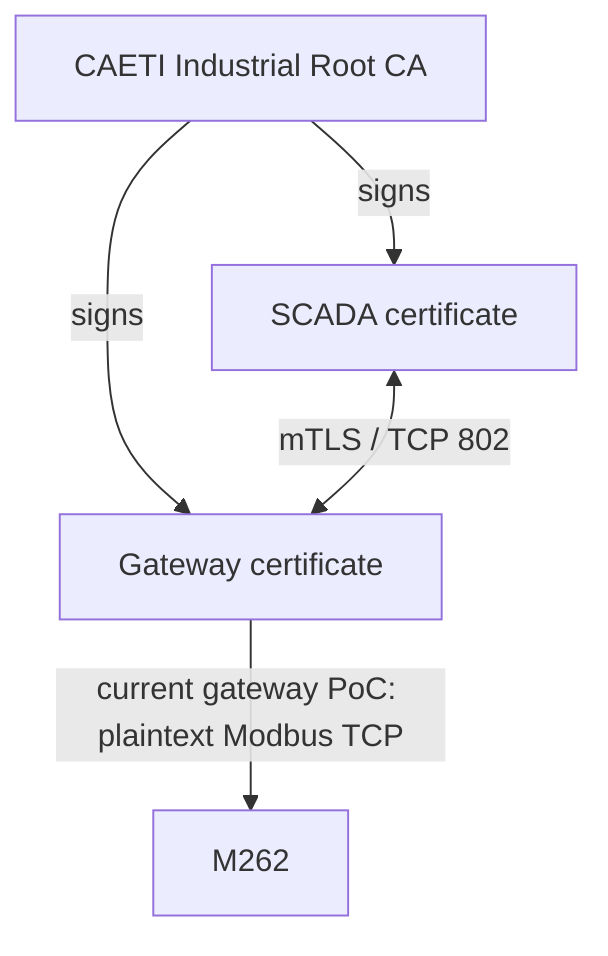

# industrialPKI — Complete Deployment and Operation Guide

## 1. Purpose

`industrialPKI` protects the SCADA-to-M262 Modbus path with mutual TLS and X.509 certificates while keeping a Delta PLC as a plaintext Modbus/TCP comparison path.

### Emulator topology

```text
M262
SCADA -- Modbus/TLS :802 --> Docker/stunnel Gateway -- Modbus/TCP :1502 --> M262 emulator

Delta
SCADA ------------------------------------------------ Modbus/TCP :1503 --> Delta emulator
```

### Physical topology

```text
M262
SCADA -- Modbus/TLS :802 --> Raspberry Pi TLS Gateway -- Modbus/TCP :502 --> M262

Delta
SCADA ------------------------------------------------ Modbus/TCP :502 --> Delta
```

Important: TLS terminates at the gateway. The protected segment is **SCADA ↔ gateway**. The gateway ↔ M262 backend remains plaintext Modbus/TCP. Do not describe the solution as native end-to-end M262 TLS unless the physical controller is later proven to terminate TLS itself.

---

## 2. Validated project state

The following items have already been validated in the emulator laboratory:

```text
[x] CAETI Root CA generated
[x] Gateway X.509 certificate generated
[x] SCADA client X.509 certificate generated
[x] Certificate chain validated
[x] Mutual TLS client authentication validated
[x] TLS gateway exposed on TCP/802
[x] Gateway reaches the M262 emulator on TCP/1502
[x] SCADA reads/writes M262 emulator through TLS/802
[x] Gateway OFF -> new/repeated M262 connection attempt fails
[x] Gateway ON  -> M262 path restored
[x] Delta remains independent over plain Modbus/TCP
[x] Wireshark shows TLS 1.3 Encrypted Application Data on TCP/802
[x] Gateway log shows CAETI SCADA certificate acceptance
[ ] Physical M262 coil offsets confirmed
[ ] Physical M262 end-to-end validation
[ ] Physical Raspberry Pi gateway validation in Neuquén
```

---

## 3. Repository structure

```text
industrialPKI/
├── attack/
│   ├── modifPLC.py
│   └── README.md
├── docs/
│   ├── images/
│   └── PKI_Modbus_TLS_M262.md
├── emulator/
│   ├── plc_emulator.py
│   └── README.md
├── gateway/
│   ├── Dockerfile
│   ├── entrypoint.sh
│   └── stunnel.conf
├── pki/
│   ├── ca/
│   ├── gateway/
│   ├── scada/
│   └── README.md
├── scada/
│   ├── scada_dual_m262_delta.py
│   ├── scada_dual_config_emulator.json
│   ├── scada_dual_config_physical.json
│   └── README.md
├── scripts/
├── .env.emulator
├── .env.physical
├── .gitignore
├── docker-compose.yml
└── requirements.txt
```

Generated private credentials, the active `.env`, the active `scada_dual_config.json`, packet captures, logs and `.venv` are intentionally excluded from Git.

---

# PART I — CA WORKSTATION / DEVELOPMENT MACHINE

## 4. Clone or copy the repository

Recommended location:

```bash
mkdir -p ~/Documents/Proyectos
cd ~/Documents/Proyectos
git clone <REPOSITORY_URL> industrialPKI
cd industrialPKI
```

For a ZIP deployment:

```bash
cd ~/Documents/Proyectos
unzip industrialPKI.zip
cd industrialPKI
```

Always execute project commands from the repository root unless explicitly stated otherwise.

Check:

```bash
pwd
```

Expected form:

```text
/home/<user>/Documents/Proyectos/industrialPKI
```

---

## 5. Create the Python environment

### Automated method

```bash
./scripts/bootstrap_dev.sh
```

This creates `.venv`, upgrades `pip`, and installs `requirements.txt`.

### Manual equivalent

```bash
python3 -m venv .venv
source .venv/bin/activate
python -m pip install --upgrade pip
pip install -r requirements.txt
```

The tested PyModbus target is:

```text
pymodbus==3.15.0
```

Verify:

```bash
.venv/bin/python --version
.venv/bin/python -c "import pymodbus; print(pymodbus.__version__)"
```

For the Tkinter SCADA GUI on Debian/Ubuntu-family systems:

```bash
sudo apt update
sudo apt install python3-tk
```

---

## 6. Generate the CAETI PKI

The CA identity is:

```text
C  = AR
O  = CAETI
OU = Industrial Security Lab
CN = CAETI Industrial Root CA
```

The gateway identity is:

```text
C  = AR
O  = CAETI
OU = OT
CN = modbus-m262-gateway
```

The SCADA identity is:

```text
C  = AR
O  = CAETI
OU = SCADA
CN = scada-testbed
```

### Generate a new PKI

Use the planned physical gateway IP as the argument. Current testbed value:

```bash
./scripts/generate_pki.sh 192.168.0.24
```

The gateway certificate receives SAN entries for:

```text
DNS:modbus-m262-gateway
IP:127.0.0.1
IP:<gateway IP supplied to generate_pki.sh>
```

If the physical gateway IP will be different, generate the PKI with the real IP instead.

### Verify the certificate chain

```bash
openssl verify \
  -CAfile pki/ca/certs/rootCA.crt \
  pki/gateway/certs/gateway.crt \
  pki/scada/certs/scada.crt
```

Expected:

```text
pki/gateway/certs/gateway.crt: OK
pki/scada/certs/scada.crt: OK
```

Check subjects:

```bash
openssl x509 -in pki/ca/certs/rootCA.crt -noout -subject
openssl x509 -in pki/gateway/certs/gateway.crt -noout -subject
openssl x509 -in pki/scada/certs/scada.crt -noout -subject
```

All three must show `O = CAETI`.

### Existing laboratory PKI

If intentionally replacing an existing PKI, use:

```bash
./scripts/regenerate_pki_caeti.sh
```

That script creates a timestamped backup before replacing the credentials.

---


### PKI trust model



The Root CA private key is used only for certificate issuance and remains on the CA workstation.

## 7. Credential ownership and distribution

Yes: for the current architecture, Jorge must receive the credentials required by the **gateway**, but he must **not** receive the Root CA private key.

### Never leave the CA workstation

```text
pki/ca/private/rootCA.key
```

This is the signing key for the entire PKI.

### Raspberry Pi / gateway requires

```text
rootCA.crt
gateway.crt
gateway.key
```

### SCADA host requires

```text
rootCA.crt
scada.crt
scada.key
```

### Create deployment bundles automatically

On the CA workstation:

```bash
./scripts/export_credentials.sh
```

This creates:

```text
dist/gateway_credentials.tar.gz
dist/scada_credentials.tar.gz
```

`rootCA.key` is deliberately excluded.

### Transfer to Jorge

Use one of the following:

```text
- controlled USB/removable media
- SCP/SFTP over a trusted channel
- another authenticated encrypted transfer mechanism
```

Do **not**:

```text
- commit credentials to GitHub
- send gateway.key/scada.key through public chat or ordinary email
- send rootCA.key to the Raspberry Pi
```

For a production-grade PKI, the stronger design is to generate the gateway private key directly on the Raspberry Pi and send only a CSR to the CA workstation. For this research/laboratory deployment, the pre-provisioned gateway bundle is the fastest reproducible method.

---

# PART II — LOCAL EMULATOR DEMONSTRATION

## 8. Select the emulator profile

```bash
./scripts/select_emulator.sh
```

This performs:

```text
.env.emulator -> .env
scada/scada_dual_config_emulator.json -> scada/scada_dual_config.json
```

Current emulator endpoints:

```text
M262 SCADA endpoint: 127.0.0.1:802, TLS, Unit ID 255
Gateway backend:     host.docker.internal:1502
Delta SCADA endpoint:127.0.0.1:1503, TCP, Unit ID 1
```

The emulator uses TCP/1502 and TCP/1503 specifically to make the laboratory paths visually distinct from physical Modbus TCP/502.

---

## 9. One-command preparation

```bash
./scripts/demo_prepare.sh
```

This:

```text
1. selects the emulator profile
2. creates/updates the Python virtual environment
3. installs PyModbus
4. verifies that required PKI files exist
5. prints the three commands used for the demonstration
```

---

## 10. Start the full local demonstration

Use three terminals.

### Terminal 1 — dual PLC emulator

```bash
cd ~/Documents/Proyectos/industrialPKI
./scripts/run_emulator.sh
```

Expected endpoints:

```text
M262 emulator:  0.0.0.0:1502, Unit ID 255
Delta emulator: 0.0.0.0:1503, Unit ID 1
```

Typical runtime output:

```text
M262: mode=normal   R=1 A=0 V=0
Delta: mode=stopped R=0 A=0 V=0
```

### Terminal 2 — PKI/TLS gateway

```bash
cd ~/Documents/Proyectos/industrialPKI
./scripts/run_gateway.sh
```

Expected startup:

```text
Configuration successful
```

When the SCADA connects to the M262 path, expected evidence includes:

```text
Certificate accepted at depth=0: C=AR, O=CAETI, OU=SCADA, CN=scada-testbed
s_connect: connected 172.17.0.1:1502
Service [modbus-m262] connected remote server
```

The exact Docker bridge addresses can vary. The important points are certificate acceptance and successful connection to the TCP/1502 backend.

### Terminal 3 — SCADA

```bash
cd ~/Documents/Proyectos/industrialPKI
./scripts/run_scada.sh
```

Connect both PLCs from the GUI.

Expected:

```text
M262: CONNECTED / ONLINE
Delta: CONNECTED / ONLINE
```

M262 traffic follows:

```text
SCADA -> TLS/802 -> gateway -> TCP/1502 -> M262 emulator
```

Delta traffic follows:

```text
SCADA -> TCP/1503 -> Delta emulator
```

---

## 11. Check the laboratory state

```bash
./scripts/lab_status.sh
```

Useful manual check:

```bash
ss -ltnp | grep -E ':802|:1502|:1503'
```

Expected while everything is running:

```text
802  -> Docker/stunnel gateway
1502 -> Python M262 emulator
1503 -> Python Delta emulator
```

---

## 12. Prove that the gateway is mandatory

With the emulator still running and the SCADA connected:

```bash
docker stop industrialpki-gateway
```

Expected security result:

```text
A new/repeated M262 connection attempt fails while the emulator remains alive on TCP/1502.
Delta remains independently available.
```

The stable SCADA does not run an automatic transport-health watchdog. Therefore, if the gateway is stopped after an established connection, the GUI can retain a stale `CONNECTED/ONLINE` indication until disconnect/reconnect or a fresh SCADA session. Do not use the stale label as evidence of connectivity.

The M262 emulator itself is still alive on TCP/1502, proving that the SCADA is not bypassing TLS and connecting directly to the emulator.

Check:

```bash
ss -ltnp | grep -E ':802|:1502|:1503'
```

With the gateway stopped:

```text
802  -> no listener
1502 -> emulator still listening
1503 -> emulator still listening
```

Restart:

```bash
docker start industrialpki-gateway
```

Then press `CONNECT` again in the M262 SCADA panel.

Expected:

```text
M262 -> CONNECTED / ONLINE
```

---

## 13. Direct mTLS test with OpenSSL

```bash
openssl s_client \
  -connect 127.0.0.1:802 \
  -cert pki/scada/certs/scada.crt \
  -key pki/scada/private/scada.key \
  -CAfile pki/ca/certs/rootCA.crt
```

Expected:

```text
Verify return code: 0 (ok)
```

A client without a certificate trusted by the CAETI Root CA must be rejected by the gateway.

---

## 14. Wireshark validation

Capture on `any` for the local single-machine demonstration.

### Protected side

Display filter:

```text
tcp.port == 802
```

Expected protocol evidence:

```text
TLSv1.3 Client Hello
TLSv1.3 Server Hello
TLSv1.3 Application Data
Encrypted Application Data
```

Modbus function codes, coil addresses and values must not be readable in plaintext on this segment.

### Gateway backend / emulator side

Display filter:

```text
tcp.port == 1502
```

Expected:

```text
Modbus/TCP decoded in plaintext
```

This provides the clearest experimental comparison:

```text
SCADA side of gateway -> TLS/802 encrypted
backend side           -> Modbus/TCP/1502 plaintext
```

### Delta emulator comparison

```text
tcp.port == 1503
```

Delta remains plaintext Modbus/TCP by design.

---

## 15. Stop the local gateway

```bash
./scripts/stop_gateway.sh
```

Stop the emulator and SCADA with `Ctrl+C` / normal window close.

---

# PART III — RASPBERRY PI GATEWAY FOR NEUQUÉN

## 16. Raspberry Pi role

The Raspberry Pi is the physical TLS gateway:

```text
SCADA -- mTLS/TCP 802 --> Raspberry Pi -- Modbus/TCP 502 --> M262
```

The Raspberry Pi does not need the CA private key and does not need to run the SCADA or emulator for the physical deployment.

Recommended:

```text
Raspberry Pi OS 64-bit
wired Ethernet for the laboratory network
stable/static address or DHCP reservation
current planned gateway IP: 192.168.0.24
```

If the IP changes, reissue the gateway certificate with the actual IP in the SAN and update the physical SCADA profile.

---

## 17. Prepare the Raspberry Pi OS and obtain the repository

On the Raspberry Pi:

```bash
sudo apt update
sudo apt full-upgrade -y
sudo apt install -y git unzip
sudo reboot
```

After reboot:

```bash
hostname -I
ip addr
```

Assign or reserve the required gateway IP. For the current profile:

```text
192.168.0.24
```

Then obtain the project.

From GitHub:

```bash
mkdir -p ~/Documents
cd ~/Documents
git clone <REPOSITORY_URL> industrialPKI
cd industrialPKI
```

Or copy the sanitized project ZIP to the Raspberry Pi and unpack it:

```bash
mkdir -p ~/Documents
cd ~/Documents
unzip /path/to/industrialPKI_GitHub_ready_CAETI.zip
```

Enter the actual repository root before running any project script.

---

## 18. Install Docker Engine and Compose on Raspberry Pi

From the repository root:

```bash
./scripts/bootstrap_raspberry_gateway.sh
```

The script supports Raspberry Pi OS/Raspbian, Debian and Ubuntu-family systems by configuring the corresponding Docker repository. For 64-bit Raspberry Pi OS (`arm64`), it uses Docker's Debian arm64 repository as recommended by current Docker documentation and installing:

```text
docker-ce
docker-ce-cli
containerd.io
docker-buildx-plugin
docker-compose-plugin
```

It also enables Docker and adds the current user to the `docker` group.

After the script finishes, log out and back in once.

Verify:

```bash
docker --version
docker compose version
systemctl status docker --no-pager
```

Docker's Linux Compose plugin is the expected interface:

```text
docker compose ...
```

not the legacy `docker-compose` command.

---

## 19. Verify Raspberry networking before credential deployment

The Raspberry must be able to reach the physical M262 backend:

```text
M262 192.168.0.25:502
```

When the PLC is present:

```bash
ping -c 3 192.168.0.25
nc -vz 192.168.0.25 502
```

Check that the project is in the expected directory and that Compose sees its configuration:

```bash
pwd
ls
docker compose config
```

Do not continue until the gateway host has the intended address and the PLC-side route is correct.

---

## 20. Provision the gateway credentials on the Raspberry Pi

On the CA workstation, create the bundle:

```bash
./scripts/export_credentials.sh
```

Transfer only:

```text
dist/gateway_credentials.tar.gz
```

to Jorge/the Raspberry Pi using a trusted transfer method.

On the Raspberry Pi, after Docker installation and one re-login, the fastest path is the one-command provisioning wrapper:

```bash
./scripts/provision_raspberry_gateway.sh /path/to/gateway_credentials.tar.gz
```

It installs the gateway credentials, selects the physical `.env` backend, builds the container, starts it, and prints status.

Manual equivalent:

```bash
./scripts/install_gateway_credentials.sh /path/to/gateway_credentials.tar.gz
./scripts/deploy_physical_gateway.sh
```

Verify:

```bash
ls -l pki/ca/certs/rootCA.crt
ls -l pki/gateway/certs/gateway.crt
ls -l pki/gateway/private/gateway.key
```

The private key should be readable only by its owner.

Confirm identity:

```bash
openssl x509 -in pki/gateway/certs/gateway.crt -noout -subject -ext subjectAltName
```

Expected organization:

```text
O = CAETI
```

and the real gateway IP must appear in the certificate SAN.

---

## 21. Select the physical gateway profile

```bash
./scripts/select_physical.sh
```

This creates active configuration from:

```text
.env.physical
scada/scada_dual_config_physical.json
```

Current physical gateway backend:

```text
M262_IP=192.168.0.25
M262_PORT=502
```

Check:

```bash
cat .env
```

Expected:

```text
M262_IP=192.168.0.25
M262_PORT=502
```

---

## 22. Start the Raspberry Pi physical gateway

Automated:

```bash
./scripts/deploy_physical_gateway.sh
```

Manual equivalent:

```bash
docker compose up -d --build
docker compose ps
```

Check logs:

```bash
docker compose logs -f
```

Expected startup:

```text
Configuration successful
```

Check listener:

```bash
ss -ltnp | grep ':802'
```

Expected:

```text
0.0.0.0:802 LISTEN
```

---

## 23. Configure the physical SCADA host

The SCADA host needs its own deployment bundle, created on the CA workstation:

```text
dist/scada_credentials.tar.gz
```

Install automatically from the transferred bundle:

```bash
./scripts/install_scada_credentials.sh /path/to/scada_credentials.tar.gz
```

This installs:

```text
pki/ca/certs/rootCA.crt
pki/scada/certs/scada.crt
pki/scada/private/scada.key
```

Select the physical profile:

```bash
./scripts/select_physical.sh
```

Physical M262 SCADA endpoint:

```text
IP:        192.168.0.24
Port:      802
Unit ID:   255
Transport: TLS
```

Because the CAETI gateway certificate is issued with `IP:192.168.0.24` in the SAN, the physical profile uses hostname/IP checking.

Physical Delta endpoint:

```text
IP:        192.168.0.15
Port:      502
Unit ID:   1
Transport: TCP
```

---

## 24. Physical M262 Modbus configuration

Before SCADA control, verify:

```text
M262 IP: 192.168.0.25
Modbus TCP server: enabled
TCP/502: reachable from Raspberry Pi
Unit ID: 255 for the embedded server path being tested
```

The physical M262 Modbus coil offsets are deliberately blank in:

```text
scada/scada_dual_config_physical.json
```

They must be filled only after confirmation against the actual program loaded in the PLC.

Required fields:

```text
addr_turn_on
addr_emergency
addr_hacked
addr_red
addr_yellow
addr_green
```

Do not invent offsets.

Once confirmed, update the physical template, then re-select it:

```bash
./scripts/select_physical.sh
```

---

## 25. Physical Delta mapping currently used

Current testbed map:

```text
Y0 RED        -> 1281
Y1 YELLOW     -> 1282
Y2 GREEN      -> 1283
Y3 START/STOP -> 1284
Y5 HACKED     -> 1286
```

Control values:

```text
START -> 1
STOP  -> 0
```

The physical emergency address remains blank until the final Delta ladder mapping is confirmed.

---

## 26. Physical end-to-end test

Start the Raspberry gateway:

```bash
./scripts/deploy_physical_gateway.sh
```

On the SCADA host:

```bash
./scripts/run_scada.sh
```

Connect M262.

Expected Raspberry gateway log:

```text
Certificate accepted at depth=0: C=AR, O=CAETI, OU=SCADA, CN=scada-testbed
s_connect: connected 192.168.0.25:502
```

Then validate:

```text
[ ] M262 ONLINE
[ ] red/yellow/green states update
[ ] START works
[ ] STOP works
[ ] HACKED works only where intentionally enabled for the controlled testbed
[ ] EMERGENCY works after its address is confirmed
[ ] SYNCHRONIZE operates both PLC programs as intended
```

---

## 27. Physical Wireshark evidence

### SCADA ↔ Raspberry gateway

Filter:

```text
tcp.port == 802
```

Expected:

```text
TLS 1.2/1.3
Encrypted Application Data
```

### Raspberry gateway ↔ M262

Filter on the relevant gateway/PLC segment:

```text
tcp.port == 502 && ip.addr == 192.168.0.25
```

Expected:

```text
plaintext Modbus/TCP
```

### Delta

```text
tcp.port == 502 && ip.addr == 192.168.0.15
```

Expected:

```text
plaintext Modbus/TCP
```

The location of the capture matters. A mirror port that can observe the gateway-to-M262 backend will still see plaintext Modbus because TLS terminates at the gateway.

---

## 28. Make the gateway persistent across reboot

`docker-compose.yml` uses:

```text
restart: unless-stopped
```

Docker itself is enabled with systemd during bootstrap.

Test:

```bash
sudo reboot
```

After reboot:

```bash
docker ps
ss -ltnp | grep ':802'
```

The gateway should return automatically unless it was explicitly stopped.

---

## 29. Update/redeploy the gateway

From the Raspberry repository:

```bash
git pull
```

Then:

```bash
docker compose down
docker compose up -d --build
```

Credentials remain local and are not pulled from GitHub.

---

# PART IV — GITHUB PUBLICATION

## 30. What belongs in GitHub

Publish:

```text
Python source code
Dockerfile / Compose files
stunnel configuration
profile templates
helper scripts
documentation
SCADA screenshots
Wireshark evidence screenshots that contain no secrets
README files
```

Do not publish:

```text
.venv/
.env
rootCA.key
gateway.key
scada.key
operational CSRs/certificates
credential deployment bundles
packet captures unless intentionally sanitized
```

Before pushing:

```bash
git status --ignored
```

Search for accidental private keys:

```bash
grep -R --line-number "BEGIN .*PRIVATE KEY" . --exclude-dir=.git --exclude-dir=.venv || true
```

There should be no private key content in tracked files.

---

## 31. Recommended GitHub evidence format

### Use screenshots for the SCADA

Recommended images already included under `docs/images/`:

```text
scada_tls_connected.png
scada_gateway_offline.png
wireshark_tls_encrypted.png
```

The SCADA is graphical, so screenshots communicate the result better than text alone.

### Use text blocks for emulator output

Example:

```text
M262: mode=normal   R=1 A=0 V=0
Delta: mode=stopped R=0 A=0 V=0
```

### Use text blocks for gateway logs

Example:

```text
Certificate accepted at depth=0: C=AR, O=CAETI, OU=SCADA, CN=scada-testbed
s_connect: connected 172.17.0.1:1502
Service [modbus-m262] connected remote server
```

This is preferable to a terminal screenshot because the text is searchable, copyable and easy to reproduce.

### Keep at least one Wireshark screenshot

Because traffic confidentiality is a central result, retain one clear screenshot showing:

```text
TLSv1.3 Record Layer: Application Data
Encrypted Application Data
```

---

# PART V — OPERATING CHEAT SHEET

## 32. Emulator demo

Prepare once:

```bash
./scripts/demo_prepare.sh
```

Terminal 1:

```bash
./scripts/run_emulator.sh
```

Terminal 2:

```bash
./scripts/run_gateway.sh
```

Terminal 3:

```bash
./scripts/run_scada.sh
```

Status:

```bash
./scripts/lab_status.sh
```

Stop gateway:

```bash
./scripts/stop_gateway.sh
```

---

## 33. Physical Raspberry gateway

One-time OS/Docker preparation:

```bash
./scripts/bootstrap_raspberry_gateway.sh
```

After re-login, provision and deploy in one command:

```bash
./scripts/provision_raspberry_gateway.sh /path/to/gateway_credentials.tar.gz
```

Logs:

```bash
docker compose logs -f
```

---

## 34. Final acceptance checklist

### PKI

```text
[ ] Root CA subject contains O=CAETI
[ ] gateway certificate subject contains O=CAETI
[ ] SCADA certificate subject contains O=CAETI
[ ] gateway SAN contains its physical IP
[ ] rootCA.key exists only on CA workstation
```

### Emulator

```text
[x] M262 emulator TCP/1502
[x] Delta emulator TCP/1503
[x] SCADA M262 endpoint TLS/802
[x] mTLS certificate accepted
[x] gateway stop breaks M262 path
[x] gateway restart restores M262 path
[x] Wireshark shows encrypted TLS/802
```

### Physical

```text
[ ] Raspberry reachable at gateway IP
[ ] TCP/802 listening
[ ] Raspberry reaches M262 TCP/502
[ ] M262 physical coil offsets confirmed
[ ] SCADA M262 connects through mTLS
[ ] physical commands verified
[ ] Delta plain Modbus comparison verified
[ ] final Wireshark evidence captured
```

---

## 35. External installation references

Docker Engine / Debian:

```text
https://docs.docker.com/engine/install/debian/
```

Docker Engine / Raspberry Pi OS:

```text
https://docs.docker.com/engine/install/raspberry-pi-os/
```

Docker Compose plugin:

```text
https://docs.docker.com/compose/install/linux/
```

---

## Final operational notes

### Public GitHub repository versus operational deployment

The public repository must not contain an active `.env`, `scada/scada_dual_config.json`, private keys, CSRs, CA serial files, or operational certificates. These files are generated or installed locally after cloning.

### Credential provisioning choices

For the fastest laboratory/Neuquén deployment, generate and sign the CAETI PKI on the CA workstation and securely transfer `dist/gateway_credentials.tar.gz` to the Raspberry Pi. The bundle contains only the Root CA public certificate and the gateway certificate/private key; it never contains `rootCA.key`.

For stronger private-key custody, generate `gateway.key` directly on the Raspberry Pi and use a CSR signing workflow so the private key never leaves the gateway. This is recommended as a future hardening step but is not required for the current laboratory PoC.

### Fail-fast gateway configuration

The Docker Compose configuration now requires both `M262_IP` and `M262_PORT`. If `.env` is missing or incomplete, Compose fails immediately rather than starting stunnel with an empty backend target.

Use:

```bash
./scripts/select_emulator.sh
```

or:

```bash
./scripts/select_physical.sh
```

before starting the gateway.
